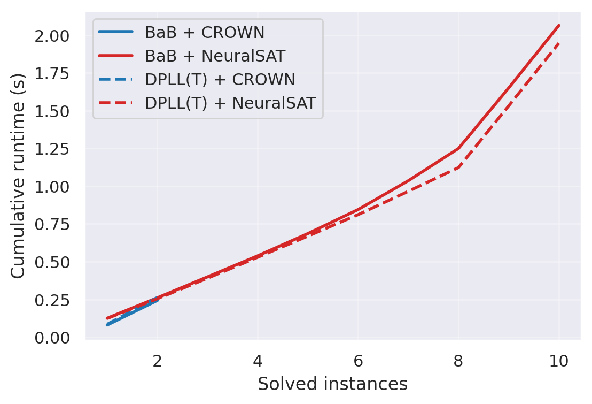

# Search and abstraction comparison

BaB and DPLL(T), each with CROWN and NeuralSAT bounds, on random FC + ReLU
networks with convex input constraints.

## Setup

- **Instance:** a random `8-24-24-3` net, a point `x0` and a radius `eps`. Is
  `label` still the argmax on the l_inf ball around `x0`, cut by a halfspace
  through `x0` and an l2 ball?
- **Radius:** `eps` is 1.02, 1.05, 1.1 or 1.2 times the largest radius plain
  CROWN verifies, so every instance starts just beyond what bounding proves.
- **Abstractions:** CROWN ignores the constraints; NeuralSAT uses them. A
  NeuralSAT gain therefore measures what the constraints buy, not tighter
  bounds on the same region.
- **Searches:** both start with a PGD attack, then split unstable ReLUs.
- **Status:** `unsat` (property proven), `sat` (counterexample found) or
  `unknown` (stuck or out of the 2 s timeout). Solved means `unsat` or `sat`.

## Reproduce

From `writeup/`:

```bash
make exp    # data/csv/{search}_{abstraction}.csv, resumable
make plot   # data/figure/cactus.png and a summary table
make progress   # done / unsat / sat / unknown per configuration
make clean  # delete results and figure
make view   # dark preview of this file
```

Each CSV row: `idx, search, abstraction, eps, status, error, dt`.

## Results



Cactus plot: solved instances (x) against cumulative runtime (y); a curve
further right and lower is better. Instances solved by all four configurations
are left out (`python -m writeup.plot.cactus --all` keeps them).

Not collected yet: run `make exp plot` and paste the table here.
